<p align="center"></p>

<p align="center">
  Run a pro-style Valorant map veto for Bo1, Bo2, Bo3 and Bo5, then share the plan with your team.
</p>

<p align="center">
  <a href="https://map-veto.tam11a.dev"><b>map-veto.tam11a.dev</b></a>
  &nbsp;·&nbsp;
  <a href="#features">Features</a>
  &nbsp;·&nbsp;
  <a href="#run-it-locally">Run it locally</a>
  &nbsp;·&nbsp;
  <a href="CONTRIBUTING.md">Contributing</a>
</p>

<p align="center">
  <a href="https://github.com/tam11a/map-veto/actions/workflows/ci.yml"></a>
  <a href="https://app.netlify.com/projects/map-veto/deploys"></a>
  <a href="LICENSE"></a>
</p>

<p align="center">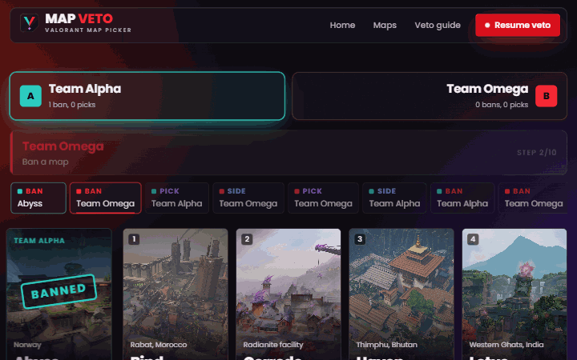</p>

Map Veto handles bans, picks, starting sides and the decider, with turn timers, rule presets and map intel. Captains can veto from their own devices in an online room, and casters can put the veto on stream with a transparent overlay. When it's done, the plan goes out as an image, a story image, a short link, text or JSON.

Free, no accounts, no ads.

## Features

### The lobby

Teams, first turn (or a coin toss), format, map pool and the exact ban/pick order, all on one screen. Start from a built-in rule set or save your own; choose who picks sides after a pick (the opponent or the picker) and how the decider's side is settled (the team that didn't ban last, a fixed team, or a knife round in game). Add an event, a date and team logos.

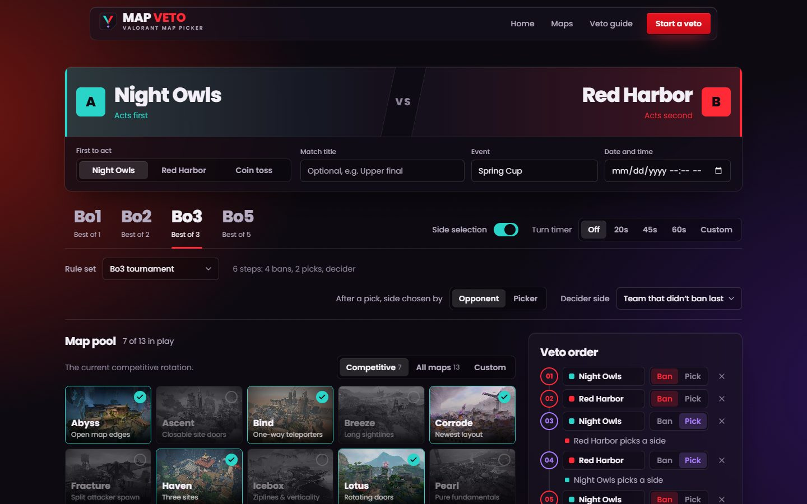

### The live veto

Every step is a click (or a key: `1`–`9` choose a map, `A`/`D` choose a side). Optional turn timer with pause, sound cues, undo, and progress saved after every step, so a refresh never loses a veto.

<table>
  <tr>
    <td width="50%">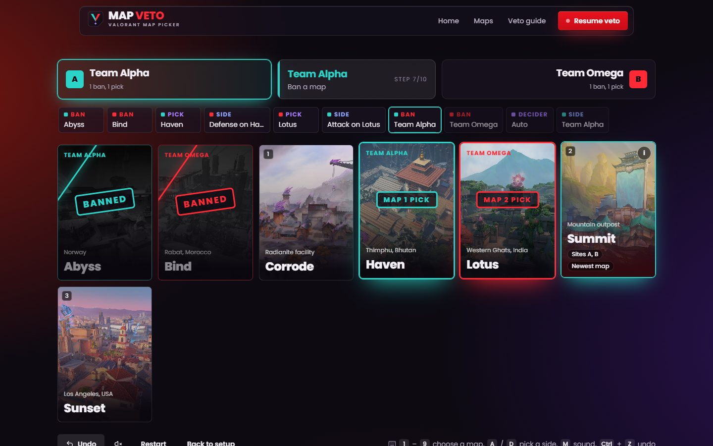</td>
    <td width="50%">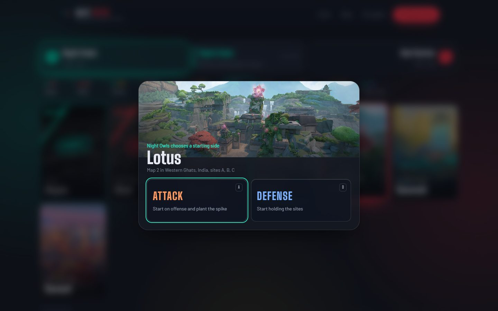</td>
  </tr>
</table>

### Online rooms and the stream overlay

**Start an online room** and the host gets one link per captain, a watch-only link and an overlay link. Each captain can only act on their own turn; every move is checked on the server and appears on every screen within about a second. The overlay is a transparent 1920×1080 view for an OBS browser source.

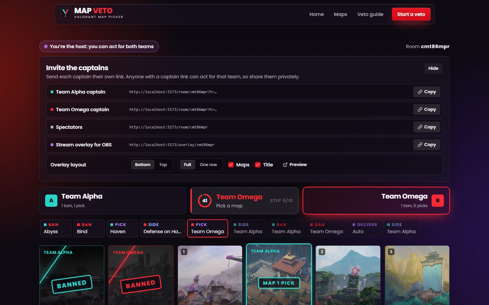
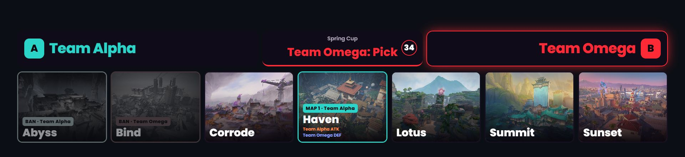

The overlay link takes layout options, so each OBS scene can use its own. The host picks them in the room's invite panel, and the copied link includes them:

| Option | Effect |
| --- | --- |
| `?pos=top` | Anchor to the top edge (default: bottom) |
| `?compact=1` | One slim row: teams, map chips and the current turn |
| `?maps=0` | Hide the maps |
| `?title=0` | Hide the match title or event line |
| `?bg=1` | Dark backdrop for previewing in a normal browser (leave it off in OBS) |

Combine them with `&`, for example `/overlay/<room-id>?pos=top&compact=1`.

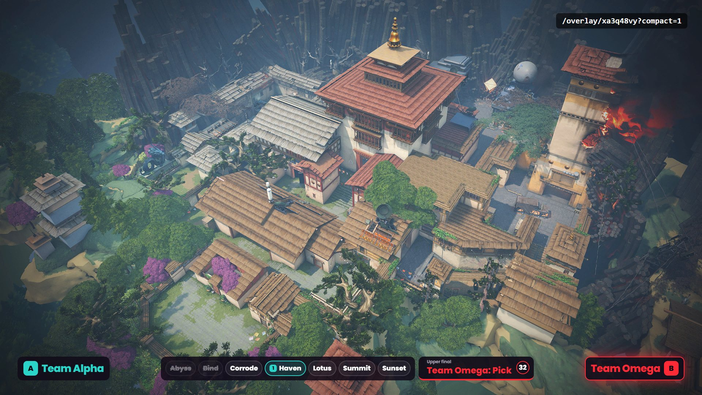

### The match plan

Maps in order, who picked them, starting sides, and your team's prep: general notes, attack and defense notes, and a five-agent comp per map. Fix a side or rename a team without replaying.

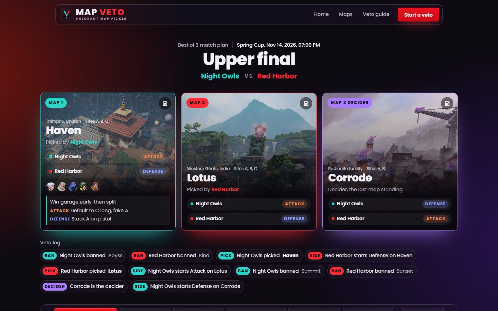

Export it as a landscape image for Discord or a 1080×1920 story image for phones:

<table>
  <tr>
    <td width="66%">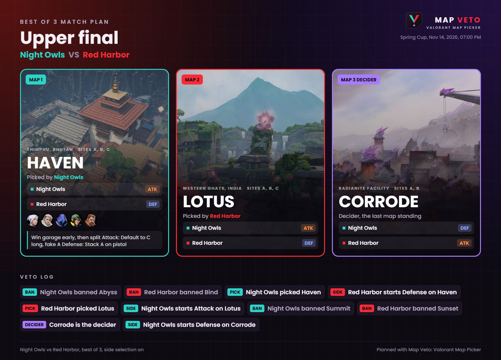</td>
    <td width="34%">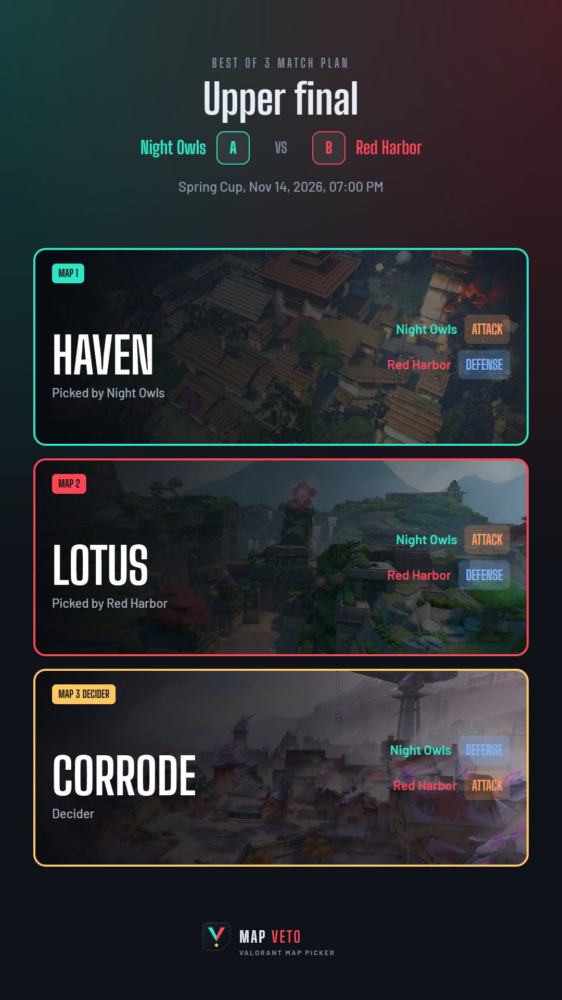</td>
  </tr>
</table>

### Maps and callouts

Filter and sort the pool, see the live competitive rotation, and open any map for its minimap with every callout pinned.

<table>
  <tr>
    <td width="50%">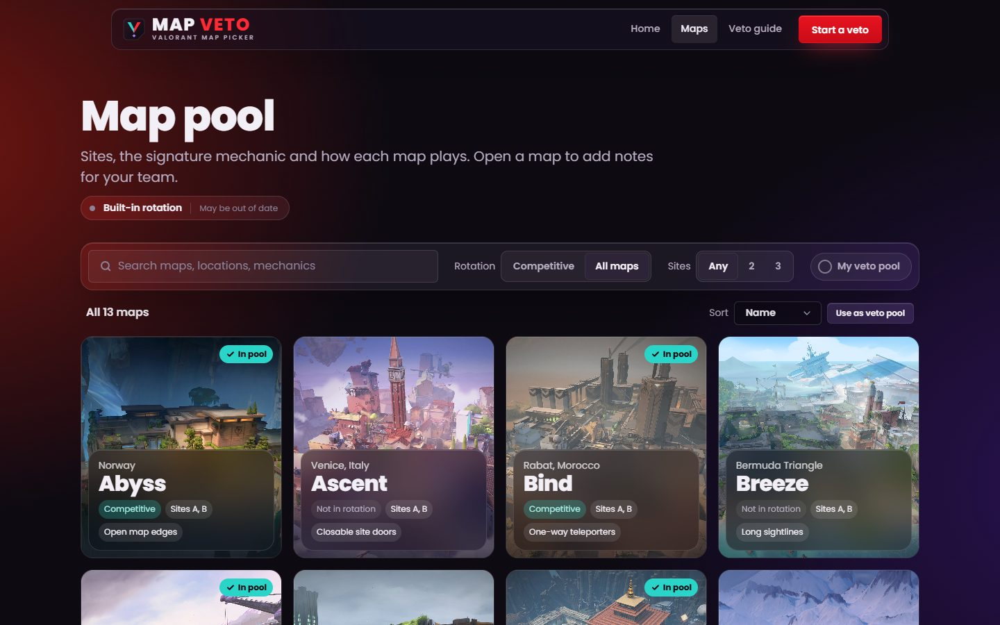</td>
    <td width="50%">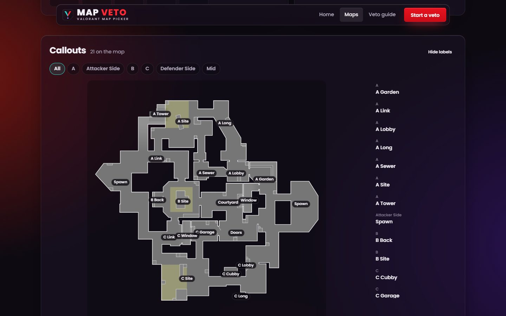</td>
  </tr>
</table>

### Everywhere else

<table>
  <tr>
    <td width="66%">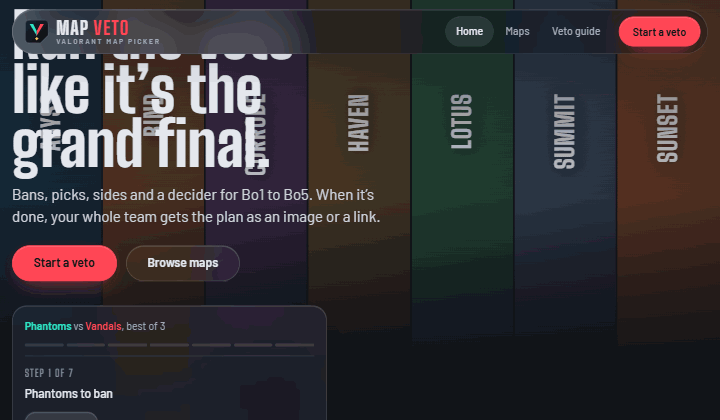</td>
    <td width="34%">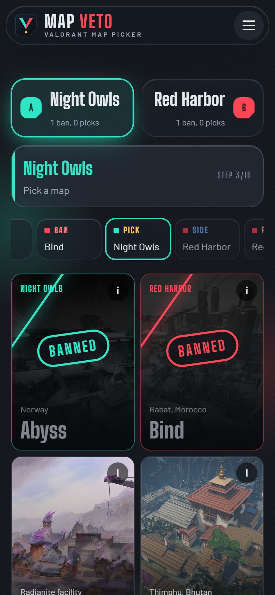</td>
  </tr>
</table>

- A landing page where visitors can try a veto by clicking the maps.
- A guide covering every format, with an example plan you can replay for each one.
- Works on phones, tablets and desktops, and by keyboard: dialogs are labelled, trap focus and hand it back when they close.
- Works offline once loaded, through a service worker.

## Run it locally

You need Node 20 or newer.

```bash
git clone https://github.com/tam11a/map-veto.git
cd map-veto
npm install
npm run dev
```

Open http://localhost:5173. The dev server also runs the API (`/api/rooms`, `/api/links`, `/api/rotation`), so online rooms work locally; local rooms are kept in memory until the server restarts.

| Command | What it does |
| --- | --- |
| `npm run dev` | Dev server with hot reload |
| `npm test` | Vitest suite: veto rules, share links, rooms, rotation parsers |
| `npm run check` | Type-check and tests, the same as CI |
| `npm run build` | Production build to `dist/` |
| `npm run preview` | Serve the production build |
| `npm run rotation` | Refresh the competitive rotation snapshot |

No environment variables are required. See [Competitive rotation](#competitive-rotation) for the optional API key.

## Deploy your own

The live site runs on Netlify. `netlify.toml` sets everything: the build, Node 20, the functions, SPA routing and caching headers.

**From Git (recommended):** in Netlify choose **Add new project → Import an existing project**, pick your fork, and deploy. Netlify sets `URL` during the build, which gives the social image, `robots.txt` and `sitemap.xml` absolute links.

**From the CLI:**

```bash
npx netlify-cli deploy --build --prod
```

Two functions deploy with the site:

| Function | Routes | What it does |
| --- | --- | --- |
| `netlify/functions/rooms.mts` | `/api/rooms`, `/api/links` | Online rooms and short links, stored in [Netlify Blobs](https://docs.netlify.com/blobs/overview/). Nothing to set up. |
| `netlify/functions/rotation.mjs` | `/api/rotation` | The competitive rotation, cached on Netlify's CDN for a day |

> Drag-and-drop deploys upload static files only, without the functions. The veto, plans and exports still work, but online rooms and short links don't.

## Competitive rotation

The competitive pool comes from the best source available, in this order:

1. **HenrikDev API**, when `HENRIK_API_KEY` is set. It reads Riot's live queue data.
2. **The [Valorant Wiki](https://valorant.fandom.com/wiki/Maps#Map_rotations)**, with no key needed. The page is community-edited and often half-updated around a new act, so its list is only used when it names exactly 7 maps.
3. **The built-in list** in `src/data/maps.ts`, checked by hand. Currently Abyss, Bind, Corrode, Haven, Lotus, Summit and Sunset.

The Maps page always says which source is in use. To add the key:

1. Get one at [api.henrikdev.xyz/dashboard](https://api.henrikdev.xyz/dashboard/).
2. Copy `.env.example` to `.env.local` and set `HENRIK_API_KEY`.
3. In production, add `HENRIK_API_KEY` (and optionally `HENRIK_REGION`) under Netlify → Site configuration → Environment variables.

The key is only read on the server: by the Netlify function, the build-time snapshot and the dev server. It never reaches the browser.

## Privacy

- Setups, notes and saved rule sets stay in your browser's local storage.
- Long share links carry the whole plan inside the URL itself.
- Online rooms and short links are stored in Netlify Blobs. Rooms close three days after the last move.
- Room seats are random tokens inside the invite links. Anyone with a captain link can act for that team, so share them privately.

## Contributing

Bug reports, ideas and pull requests are welcome. [CONTRIBUTING.md](CONTRIBUTING.md) covers the architecture, code style, testing and how to add maps, rule sets and features.

## License

[MIT](LICENSE) © tam11a. You can use, change and share the code, including commercially, as long as the copyright and license notice stay with it.

The license covers this repository's code and its own assets (the Map Veto logo and design). Map art, minimaps, callouts and agent portraits are Riot Games' property, loaded at runtime from valorant-api.com; they are not part of this repository and the license doesn't apply to them.

## Credits

- Map art, minimaps, callouts and agent portraits: [valorant-api.com](https://valorant-api.com)
- Live competitive rotation: the [HenrikDev API](https://docs.henrikdev.xyz/), which reads Riot's queue data. Thanks to HenrikDev for running it.
- Rotation fallback: the [Valorant Wiki](https://valorant.fandom.com) (CC BY-SA)
- Fonts: Big Shoulders Display and Barlow, from Google Fonts

Designed and built by [tam11a](https://tam11a.dev).

Map Veto is a fan-made tool and is not affiliated with or endorsed by Riot Games. VALORANT and all related names and artwork are trademarks of Riot Games, Inc.
